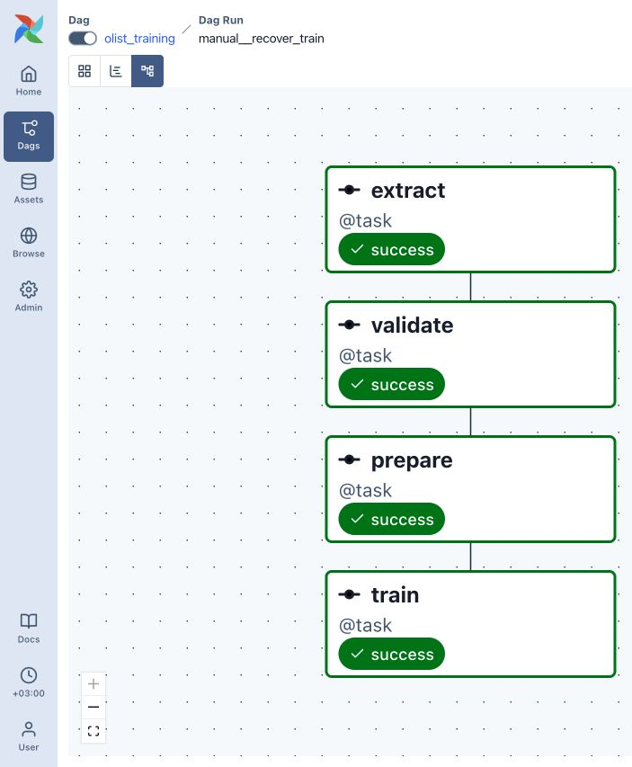
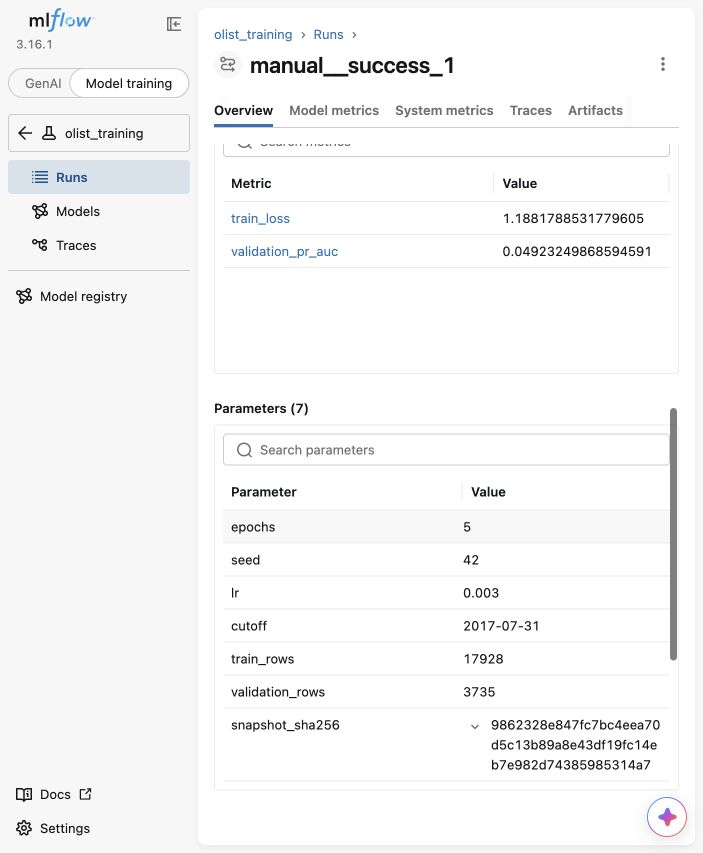

# Olist: Airflow → MLflow

Четыре отдельные задачи `extract → validate → prepare → train` читают реальные
заказы из PostgreSQL, проверяют снимок, делят данные по времени и обучают
выданную CPU-модель. Модель и преобразования из `src/olist_model.py` сохранены
без изменений. Задание: [ASSIGNMENT.md](ASSIGNMENT.md).

## Запуск с чистого клона

Нужны Git, Docker с работающим Linux engine и Docker Compose v2. На macOS
подойдёт Docker Desktop или Colima, на Windows — Docker Desktop с WSL2.
Выделите Docker не менее 4 ГБ RAM и 2 CPU; для первой сборки нужна сеть.
Python на хосте для работы проекта не требуется.

```bash
git clone https://github.com/stpetrakov/olist-homework.git
cd olist-homework
cp .env.example .env
docker compose up -d --build
docker compose ps
```

Репозиторий приватный: для клонирования нужен доступ к нему. В `.env.example`
только учебный локальный пароль; не используйте его для других систем.
`.env`, рабочие снимки, веса, логи и локальное окружение исключены из Git.
Выданная папка `data/` включена целиком. Версии образов и Python-зависимостей
закреплены; `latest` не используется.

Дождитесь `healthy` для source, mlflow и airflow. Первый старт занимает несколько
минут. Диагностика:

```bash
docker compose logs --tail=100 airflow
docker compose logs --tail=100 mlflow
docker compose exec -T airflow python -c 'import urllib.request; print(urllib.request.urlopen("http://mlflow:5000/health", timeout=5).read().decode())'
docker compose exec -T source psql -U olist -d olist -c 'SELECT count(*), count(DISTINCT order_id) FROM orders;'
```

Ожидается **21 663 строки и столько же уникальных order_id**. PostgreSQL
инициализируется выданным CSV только при первом создании volume.

| Интерфейс | Адрес на компьютере |
|---|---|
| Airflow | http://127.0.0.1:8080 |
| MLflow | http://127.0.0.1:5050 |

Оба порта опубликованы только на `127.0.0.1`; PostgreSQL наружу не опубликован.
Airflow standalone работает без пароля, поэтому сохраняйте локальную привязку.
Порты можно изменить через `AIRFLOW_PORT` и `MLFLOW_PORT` в `.env`.
Внутренние адреса `DATABASE_URL` и `MLFLOW_TRACKING_URI=http://mlflow:5000`
уже заданы в Compose. Airflow ждёт healthcheck и source, и MLflow.

## Запуски DAG

В Airflow включите `example_one_task`, нажмите Trigger и дождитесь success.
Затем включите `olist_training` и запустите вручную дважды. Аналог через CLI:

```bash
docker compose exec -T airflow airflow dags unpause example_one_task
docker compose exec -T airflow airflow dags trigger example_one_task
docker compose exec -T airflow airflow dags unpause olist_training
docker compose exec -T airflow airflow dags trigger -r manual__success_1 olist_training
# Дождитесь success первого запуска, затем:
docker compose exec -T airflow airflow dags trigger -r manual__success_2 olist_training
docker compose exec -T airflow airflow dags list-runs olist_training
```

Новые ручные запуски требуют новых Airflow run_id. Еженедельное расписание —
понедельник 00:00 UTC (03:00 МСК), `catchup=False`, `max_active_runs=1`.
У extract три повтора с паузой 30 секунд, у остальных задач — ноль повторов.
Лимиты задач: extract 5 минут, validate 2, prepare 3, train 15; всего DAG —
45 минут. У validate, prepare и train — `all_success`.

`extract` делает упорядоченный PostgreSQL COPY в обычный UTF-8 CSV. Каталог
`/opt/olist/work/runs/<SHA256 Airflow run_id>/` уникален для запуска; повтор
extract атомарно заменяет снимок. Накопления строк нет. `validate(snapshot)`
использует только чтение CSV и проверяет все обязательные колонки, уникальность
ID, даты, конечность чисел и метку 0/1.

`prepare` вызывает выданную `split_by_time`: train строго до
`2017-07-31 00:00:00`, validation начиная с границы. По умолчанию это
**17 928 / 3 735 строк**. Преобразования обучает `fit_model` только на train.
SHA256 вычисляется по исходным байтам CSV extract, до подготовки выборок.
Через XCom идут только абсолютные пути, SHA256, граница, размеры и MLflow run_id.
Все CSV и модели находятся на общем именованном volume `/opt/olist/work`.

## Эксперимент и прогноз

Откройте MLflow → Model training → эксперимент `olist_training`. Каждый
вызов train создаёт отдельный run. Тег `dag_run_id` точно равен `run_id` из
контекста Airflow. Параметры: `epochs`, `seed`, `lr`, `cutoff`, `train_rows`,
`validation_rows`, `snapshot_sha256`. Метрики `train_loss` и
`validation_pr_auc` записаны с шагами 1…epochs.

Настройки читаются из окружения: `OLIST_EPOCHS=5`, `OLIST_SEED=42`,
`OLIST_LR=0.003`, `OLIST_CUTOFF=2017-07-31`,
`MLFLOW_EXPERIMENT_NAME=olist_training`. После изменения `.env` примените
`docker compose up -d --build`.

`save_predictor` сохраняет всю модель вместе с train-преобразованиями;
MLflow хранит директорию `model/` с `weights.pt` и `preprocessing.json`.
Готовая команда скачивает этот артефакт, восстанавливает модель и выводит
пять прогнозов:

```bash
docker compose exec -T airflow python -m check_model --run-id RUN_ID
```

В новом окружении используйте MLflow run_id, полученный именно там: он виден
в MLflow и в return_value XCom задачи train. Исходный `data/olist_orders.csv.gz`
используется командой проверки только как пять входных примеров.

## Отказы и Clear

Для проверки validate временно измените extract так, чтобы он вернул
испорченную **копию** снимка с повторным order_id, и запустите отдельный DAG run.
Ожидаются extract=success, validate=failed, prepare/train=upstream_failed:
они не должны выполняться. Затем восстановите исходный код.

Для восстановления временно добавьте `raise RuntimeError('test train failure')`
в начало train и запустите другой DAG run. После падения train удалите строку.
В Airflow откройте этот запуск, выберите **только train → Clear**; снимите
выбор upstream/downstream/past/future, если они включены. Предыдущие три
успешные задачи сохраняют состояние и времена выполнения. Train повторно
использует XCom/файлы prepare и создаёт MLflow run. Изменения Python доступны
через bind mounts, пересборка для них не нужна.

## Постоянное хранение

И SQLite (`/mlflow/mlflow.db`), и артефакты (`/mlflow/artifacts`) находятся
в одном именованном `mlflow-data` volume. История Airflow и рабочие файлы
также находятся в отдельных именованных volumes.

```bash
docker compose restart
docker compose up -d --force-recreate --no-deps mlflow
docker compose ps
# После healthy повторите с прежним MLflow run_id:
docker compose exec -T airflow python -m check_model --run-id RUN_ID
```

Прежние параметры, метрики, файлы модели и прогнозы должны сохраниться.
Остановка без потери данных — `docker compose down`. **Не используйте
`docker compose down -v`**: он удаляет volumes.

## Результаты выполненных проверок

Проверено локально на Linux ARM64 в Docker/Colima с выданными версиями.
`example_one_task` завершился успешно. Два ручных полных запуска:

| Airflow run_id | MLflow run_id | Результат |
|---|---|---|
| `manual__success_1` | `ca438a48a80f47d1bf35e8ac186c7984` | 4 задачи success |
| `manual__success_2` | `4ce43094c63a443f9014cf6348b5ae2b` | 4 задачи success |

В каждом снимке — 21 663 строки и 21 663 уникальных order_id, в train/validation
— 17 928 / 3 735. SHA256 исходного CSV в обоих случаях:
`9862328e847fc7bc4eea70d5c13b89a8e43df19fc14eb7e982d74385985314a7`.
Это хеш **извлечённого CSV**, а не исходного сжатого файла в `data/`.
Для каждой метрики проверены шаги `[1, 2, 3, 4, 5]`. На пятой эпохе:
`train_loss=1.1881788531779605`, `validation_pr_auc=0.04923249868594591`.

В `manual__invalid_snapshot` extract вернул временную копию с повторным
order_id: validate=failed, prepare/train=upstream_failed с **try_number=0**,
MLflow run не создан. Airflow 3 выставляет время состояния upstream_failed
даже без выполнения; отсутствие попыток проверено по try_number и pid.

В `manual__recover_train` временное исключение остановило только train.
После исправления в UI выполнен **Clear Task Instance для одной train**.
Train завершилась со второй попытки и создала run
`45a7e1b1f1fc486faf5a4e5a35c17adb`. У extract, validate и prepare остались
try_number=1 и **точно те же start_date/end_date**. Временные изменения
полностью удалены из кода.

Выполнена команда с реальным идентификатором:

```bash
docker compose exec -T airflow python -m check_model --run-id ca438a48a80f47d1bf35e8ac186c7984
```

Пять прогнозов:
`[0.7106074094772339, 0.5012513399124146, 0.2709561884403229, 0.1435118466615677, 0.22757172584533691]`.
После `docker compose restart` и
`docker compose up -d --force-recreate --no-deps mlflow` эта же команда
успешна: параметры, метрики, полная история метрик и все пять прогнозов
**совпали точно**. Volumes не удалялись. В чистом новом окружении необходимо
использовать созданный там MLflow run_id вместо приведённого примера.

При первом включении Airflow также создал очередной scheduled run;
`catchup=False` не создаёт все пропущенные исторические интервалы.





## Проверки кода

Публичный валидатор не требует сторонних библиотек:

```bash
python3 -m unittest discover -s tests -v
```

Тесты покрывают каждый обязательный столбец, дубли, пустые/повреждённые файлы,
невалидные даты/метки и NaN/Inf, а также запрещают запись, mkdir/chdir,
сетевые соединения и запуск процессов во время validate.

## Данные и интерпретация

Источник: Olist Brazilian E-Commerce Public Dataset, `olistbr/brazilian-ecommerce`.
Данные и производная таблица — CC BY-NC-SA 4.0; см. [лицензию](data/LICENSE.md),
[описание](data/README.md) и [метаданные](data/metadata.json).
Выборка ретроспективная, только доставленные заказы. `validation_pr_auc` —
average precision; выходы class-weighted модели не являются калиброванными
вероятностями опоздания. Это воспроизведение выданного baseline, без заявления
о качестве на всех будущих заказах.
